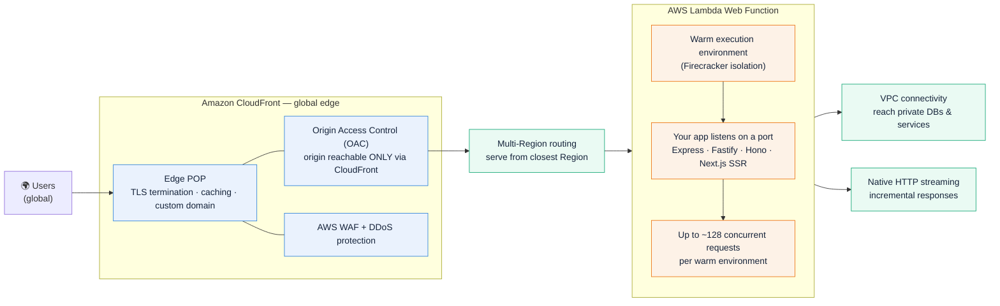
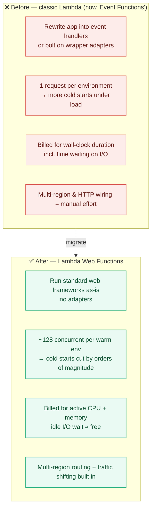
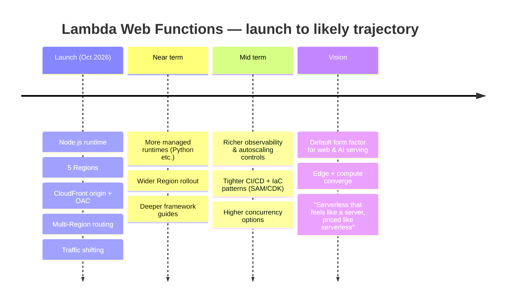

# AWS Lambda Web Functions — The Big Shift in Serverless

> **In one sentence:** On **October 12, 2026**, AWS launched **Lambda Web Functions** — a new serverless primitive where your code handles **HTTP requests directly** (no adapters, no event-handler rewrites) — and made **Amazon CloudFront** support it natively as an origin. In the same move, the classic Lambda you know is renamed **Lambda Event Functions**.

This page walks through what changed, how it helps, the pros and the caveats, where it's likely headed, and what it means for how we design serverless systems. The facts come from the official AWS announcements; the design commentary is my own.

## 1. What's new (the headline)

Two launches landed together on **Oct 12, 2026**:

| Launch | What it is |
|--------|-----------|
| **AWS Lambda Web Functions** | A new compute primitive where your code **listens on a port** and handles HTTP requests like any web server — using frameworks you already use (**Express, Fastify, Hono, Next.js SSR**) with **no adapters and no custom wiring**. |
| **CloudFront native origin support** | Amazon CloudFront can now sit in front of a Lambda Web Function as a first-class origin — with **edge TLS, caching, custom domains, Origin Access Control (OAC), WAF, and DDoS protection** — with **zero code changes**. |

### The three things that actually changed

1. **A new execution model.** The old model was **one concurrent request per execution environment**. Web Functions move to a **native HTTP model** where a **single warm environment serves up to ~128 concurrent requests**, sharing warm capacity during bursts. This cuts cold starts by orders of magnitude.
2. **A new billing model.** You pay for **active CPU time** plus the memory your environment holds — **not** for idle time your code spends **waiting** on a database query or a downstream API. I/O wait becomes nearly free compute.
3. **A naming change.** Existing Lambda functions are now called **Lambda Event Functions**. This is **a rename only** — no code changes, no redeployments required.

> **Note on runtime support at launch:** Lambda Web Functions supports the **Node.js** runtime initially. Available at launch in **US East (N. Virginia), US East (Ohio), US West (Oregon), Asia Pacific (Tokyo), and Europe (Ireland)**.

## 2. The architecture — how it fits together

**Read it left to right:** a user hits the nearest **CloudFront edge** → TLS terminates and cacheable content is served at the edge → **OAC** guarantees the request can only reach your origin through CloudFront → **multi-Region routing** sends dynamic requests to the closest Region → your **Web Function** (a normal port-listening app) handles up to ~128 concurrent requests in a warm environment, with **VPC access** and **HTTP streaming** available.

## 3. Before vs. after

## 4. How it will help

### For developers
- **Zero rewrite.** Bring an existing Express/Fastify/Hono/Next.js app and deploy it. The code that runs locally runs in production unchanged — **no adapter layer**.
- **One mental model.** Local dev and production share the same HTTP programming model, shrinking the "works on my machine" gap.
- **Streaming out of the box.** Native HTTP streaming lets you push incremental responses — ideal for **AI inference** and **SSR** that stream tokens/markup.

### For platform / SRE teams
- **Fewer cold starts.** Multi-concurrency per environment means warm capacity is reused across a burst instead of spinning a fresh sandbox per request.
- **Global by default.** Deploy once; **multi-Region, latency-based routing** serves each user from the nearest Region.
- **Safe rollouts.** **Built-in traffic shifting** (endpoint revision weights) gives native canary/weighted deployments — no sidecars or external traffic managers.

### For the business / FinOps
- **Pay for work, not waiting.** **Active-CPU billing** means I/O-bound apps (lots of DB/API waits) stop paying for idle compute — a direct cost cut for typical web workloads.
- **Enterprise security with no app changes.** CloudFront **OAC + WAF + edge DDoS** protection wraps the function without touching code.

## 5. Pros (and the honest caveats)

### Pros
- ✅ **No adapters / no rewrites** — standard port-listening web apps run directly.
- ✅ **Multi-concurrency per environment** (~128) — big cold-start reduction.
- ✅ **Active-CPU billing** — idle I/O wait costs little to nothing.
- ✅ **Native HTTP streaming** — great for AI endpoints and SSR.
- ✅ **Built-in multi-Region routing** — deploy once, serve globally with low latency.
- ✅ **Native traffic shifting** — canary and weighted rollouts without extra tooling.
- ✅ **First-class CloudFront origin** — edge TLS, caching, custom domains, OAC, WAF, DDoS, with **no code changes** and **no extra CloudFront fee** for the feature.
- ✅ **VPC connectivity** — reach private databases and services.
- ✅ **Non-breaking rename** — existing functions become "Event Functions" with zero action required.

### Caveats to plan around
- ⚠️ **Runtime breadth at launch:** Node.js first; other runtimes expected to follow.
- ⚠️ **Regional availability at launch:** five Regions initially (check the AWS Capabilities by Region page before committing).
- ⚠️ **Concurrency ceiling per environment:** ~128 concurrent requests — size and load-test accordingly for CPU-bound workloads.
- ⚠️ **New primitive = new operational patterns:** metrics, autoscaling behavior, and per-request isolation differ from Event Functions; validate observability and tuning.
- ⚠️ **CloudFront China region** is excluded from the origin feature.

## 6. Roadmap — the likely trajectory

> AWS hasn't published a formal roadmap for everything below. The launch state is fact; the forward-looking items are my own expectation of where this goes, not a commitment from AWS.

**What to watch:**
- **Runtime expansion** beyond Node.js (Python is the obvious next, given the AI-serving positioning).
- **Region expansion** toward parity with Event Functions.
- **Tooling depth** — SAM/CDK/CloudFormation patterns, Agent Toolkit for AWS workflows, and framework-specific starters.
- **Concurrency & tuning knobs** — expect more control over per-environment concurrency and scaling.

## 7. The architect's vision — why this is a "big shift"

This is more than a feature. It closes a gap that forced a trade-off for years, bringing together two worlds that used to pull in opposite directions:

- **The developer-velocity world** of standard HTTP frameworks (run anything, locally and in prod, unchanged).
- **The serverless-economics world** of zero-idle scaling and operational simplicity (no servers, pay-per-use).

**For a decade the choice was binary:** either accept Lambda's event-handler model and adapter tax to get serverless economics, or run containers/servers to keep your natural web framework. Lambda Web Functions collapses that choice.

### What it changes in how we design systems
1. **The adapter layer disappears.** Architectures stop carrying wrapper/shim code; the app *is* the deployable. Less glue = fewer failure modes.
2. **Cost modeling shifts from duration to CPU.** I/O-bound services (the majority of web APIs) get materially cheaper, which changes the build-vs-buy and serverless-vs-container math for many teams.
3. **Edge and compute merge into one story.** CloudFront + OAC + Web Functions is a **single, secure, global delivery path** — static caching and dynamic compute behind one front door, no origin bypass.
4. **AI serving becomes a native fit.** Streaming + multi-concurrency + active-CPU billing is a natural shape for **inference endpoints** and **SSR** that stream output.

### The architect's one-line summary
> **"Serverless that feels like a server to the developer, but is still priced and scaled like serverless."** The right default posture is to treat Web Functions as the **new baseline for request/response web and AI-serving workloads**, and keep **Event Functions** for event-driven pipelines, fan-out, and async processing.

### A simple decision guide

| If your workload is… | Reach for… |
|----------------------|------------|
| Request/response web app, API, SSR, AI inference, webhook | **Lambda Web Functions** |
| Event-driven (S3/SQS/EventBridge triggers), stream/batch processing, async fan-out | **Lambda Event Functions** (the classic model) |
| Global, user-facing, security-sensitive | **Web Functions + CloudFront (OAC + WAF)** |

## Sources & references

- [AWS — Lambda announces Lambda Web Functions (What's New, Oct 2026)](https://aws.amazon.com/about-aws/whats-new/2026/10/aws-lambda-web-functions/)
- [AWS News Blog — Announcing AWS Lambda Web Functions](https://aws.amazon.com/blogs/aws/announcing-aws-lambda-web-functions-for-fast-consistent-web-app-performance-anywhere/)
- [AWS — CloudFront now supports Lambda Web Functions as an origin (What's New, Oct 2026)](https://aws.amazon.com/about-aws/whats-new/2026/10/cloudfront-lambda-web-functions-origin/)
- Toe San, *"Big shift for serverless architecture: AWS Lambda Web Functions & CloudFront Integration are officially here!"* (LinkedIn, Oct 13, 2026) — for the architect's framing of why this matters.

This is a brand-new capability, so double-check the current runtimes, Regions, concurrency limits, and pricing in the AWS docs before you build on it — the specifics will move.
